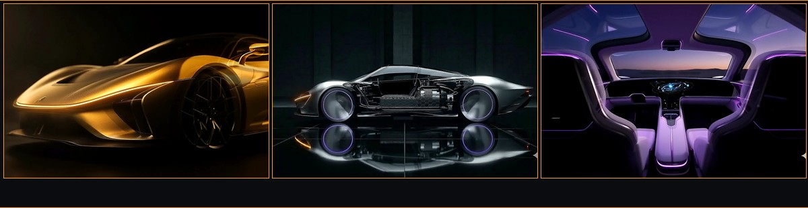
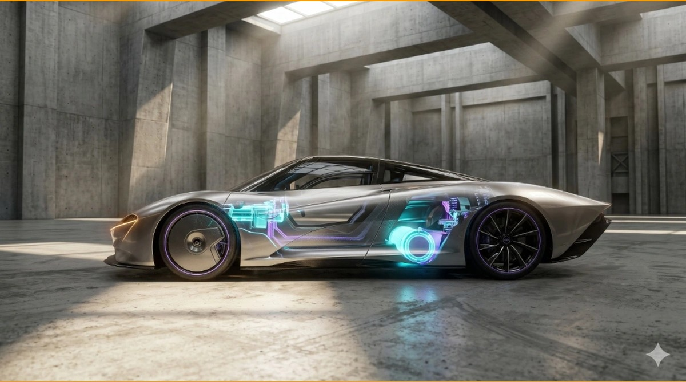
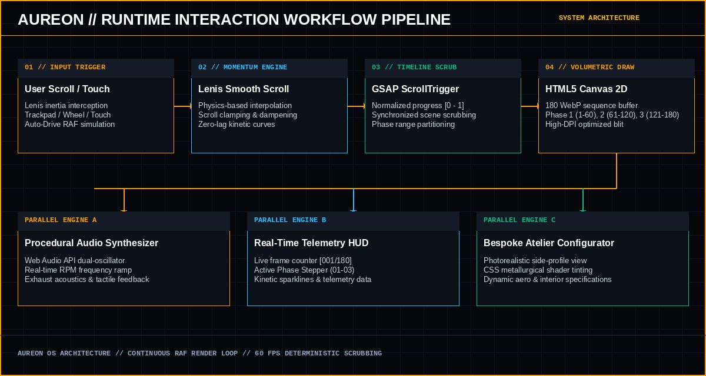
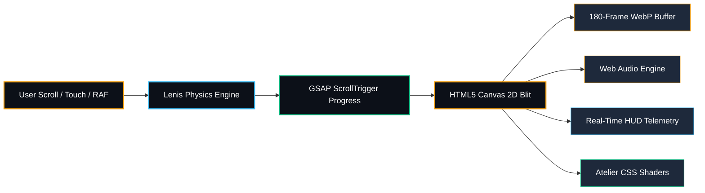
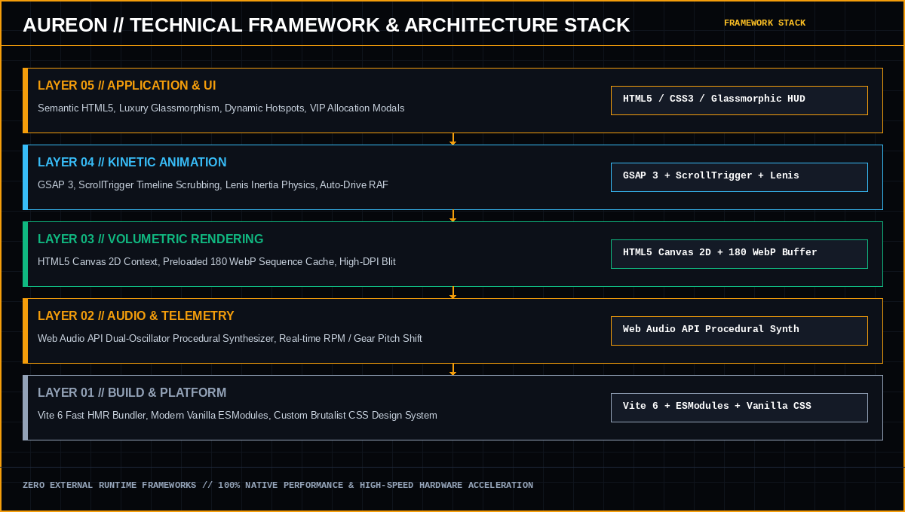

<p align="center">
  
</p>

<h1 align="center">AUREON // Hyper Sports Car Experience</h1>

<p align="center">
  <b>The Architecture of Speed & Light. Dedicated to the Relentless Perfection of Combustion, Hybrid Propulsion, and Carbo-Titanium Matrix.</b>
</p>

<p align="center">
  
  
  
  
  
</p>

---

## 🏎️ Interactive Visual Showcase

### 1. Volumetric Storytelling Phases (180 Canvas Frames)
The car dynamically rotates and deconstructs across 180 volumetric frames synchronized with momentum scrolling:

<p align="center">
  
</p>

<p align="center">
  <b>Phase 01 // The Genesis</b> (Volumetric 360 Exterior) &nbsp;&bull;&nbsp; 
  <b>Phase 02 // The Core</b> (Powertrain & Monocoque X-Ray) &nbsp;&bull;&nbsp; 
  <b>Phase 03 // The Sanctuary</b> (Driver Sanctuary Cockpit)
</p>

---

### 2. Bespoke Atelier Studio Configurator
Authentic photorealistic side-profile visualization with real-time CSS shaders for metallurgical finishes and aerodynamic trim options:

<p align="center">
  
</p>

- **01 // Exterior Metallurgical Finish**: Real-time shader adjustments for *Champagne Gold*, *Liquid Silver Chrome*, *Obsidian Matte*, and *Motorsport Titanium*.
- **02 // Aerodynamic Architecture**: Dynamic toggle between *Sprint Circuit High Downforce* (1,200 kg @ 300 km/h) and *Speedtail GT Maximum Velocity* (440 km/h).
- **03 // Cockpit Sanctuary Appointment**: Bespoke interior trims (*Saddle Cognac*, *Obsidian Race Alcantara*, *Arctic White Silk*).

---

## 🔄 Runtime Interaction Workflow Pipeline

The interaction pipeline orchestrates momentum physics, timeline progress, canvas sequence drawing, and parallel audio/telemetry loops at 60 FPS:

<p align="center">
  
</p>

### Workflow Architecture Steps:
1. **Input Capture**: User wheel, touch gestures, trackpad momentum, or autonomous Track Simulator RAF ticks.
2. **Lenis Physics Engine**: Intercepts raw scroll deltas and applies cubic-bezier inertia dampening (`cubic-bezier(0.16, 1, 0.3, 1)`).
3. **GSAP ScrollTrigger**: Normalizes scroll distance across the 3 story phases into a deterministic float `[0.000, 1.000]`.
4. **Canvas 2D Volumetric Blit**: Maps progress to the active frame index (1–180) and renders pre-buffered WebP frames to the full-viewport canvas.
5. **Parallel Subsystem Execution**:
   - **Procedural Audio Synthesizer**: Adjusts dual-oscillator frequencies and bandpass filters according to the current frame velocity.
   - **Telemetry HUD**: Updates live frame numbers, phase indicators, and kinetic sparklines.
   - **Atelier Configurator**: Handles real-time CSS SVG filters, chassis glow, and dynamic specification cards.



---

## 🏛️ Technical Framework & Architecture Stack

Built entirely on modern web standards with zero heavy framework overhead for maximum hardware acceleration:

<p align="center">
  
</p>

### Framework Stack Breakdown:

| Layer | Architecture Component | Technologies / Libraries | Core Responsibility |
| :--- | :--- | :--- | :--- |
| **Layer 05** | **Application & UI Layer** | Semantic HTML5, Vanilla CSS3 | Glassmorphic HUD, Hotspot Radar Pings, Commissioning Modals |
| **Layer 04** | **Kinetic Animation & Physics** | GSAP 3, ScrollTrigger, Lenis | Scroll scrubbing, easing physics, smooth momentum interpolation |
| **Layer 03** | **Volumetric Media & Rendering** | HTML5 Canvas 2D, WebP Sequences | 180 volumetric preloaded frames, zero-jank frame blitting |
| **Layer 02** | **Audio & Telemetry Subsystem** | Native Web Audio API | Procedural dual-oscillator acoustic exhaust synthesis & RPM shift |
| **Layer 01** | **Build & Platform Runtime** | Vite 6, Modern ESModules | Sub-millisecond HMR, zero-bloat tree-shaking, production bundling |

---

## 🚀 Commands & Development Workflow

### 1. Prerequisites
Ensure you have [Node.js](https://nodejs.org/) installed:
- Node.js `v18.0.0` or higher
- npm `v9.0.0` or higher

```bash
node -v
npm -v
```

---

### 2. Clone Repository
```bash
git clone https://github.com/adarshgaurav1951/Aureon.git
cd Aureon
```

---

### 3. Install Dependencies
Install all required runtime dependencies (GSAP, Lenis, Vite):
```bash
npm install
```

---

### 4. Run Locally (Development Server)
Starts the Vite dev server with Hot Module Replacement (HMR) at `http://localhost:5173/`:
```bash
npm run dev
```

---

### 5. Build for Production
Compiles and minifies all assets into the optimized `dist/` directory:
```bash
npm run build
```

---

### 6. Preview Production Build
Locally preview the generated production build before deploying:
```bash
npm run preview
```

---

## 📁 Project Structure

```
Aureon/
├── public/
│   └── assets/
│       ├── aureon_hero_banner.jpg             # Flagship GitHub hero preview banner
│       ├── aureon_phases_showcase.jpg         # 3-Phase panoramic showcase
│       ├── aureon_configurator_preview.jpg    # Photorealistic Atelier studio preview
│       ├── aureon_workflow_architecture.png   # Interaction workflow pipeline diagram
│       ├── aureon_framework_diagram.png       # Framework architecture stack diagram
│       ├── aureon_side_profile.webp           # High-resolution car side profile render
│       ├── phase1/                            # Frames 001 - 060 (Genesis Exterior 360)
│       ├── phase2/                            # Frames 061 - 120 (Chassis & Powertrain X-Ray)
│       └── phase3/                            # Frames 121 - 180 (Cockpit Sanctuary)
├── index.html                                 # Semantic HTML5 architecture & UI overlays
├── style.css                                  # Custom CSS design system, typography & glassmorphism
├── main.js                                    # GSAP timeline, canvas renderer, configurator & audio engine
├── package.json                               # Scripts & project dependencies
├── vite.config.js                             # Vite build configuration
└── .gitignore                                 # Standard git ignore rules (node_modules, dist)
```

---

## 🔄 Git Workflow

To stage, commit, and push updates to the repository:

```bash
# Check working tree status
git status

# Stage all modified and new files
git add .

# Commit changes with a descriptive message
git commit -m "feat: your feature or update description"

# Push to the main branch on GitHub
git push origin main
```

---

## 📄 License
Private bespoke release &copy; 2026 AUREON Automotive Labs. All rights reserved.
